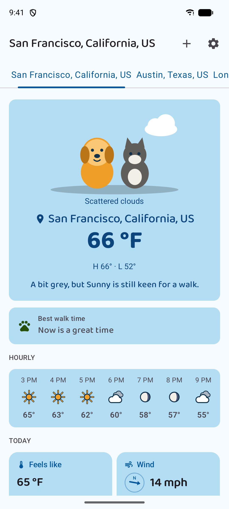
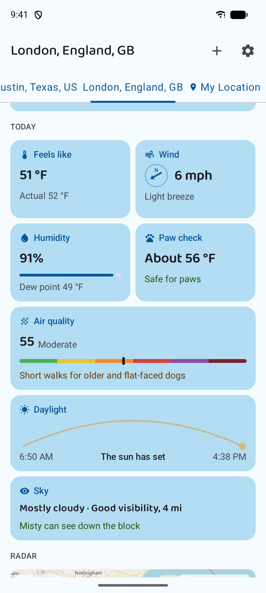
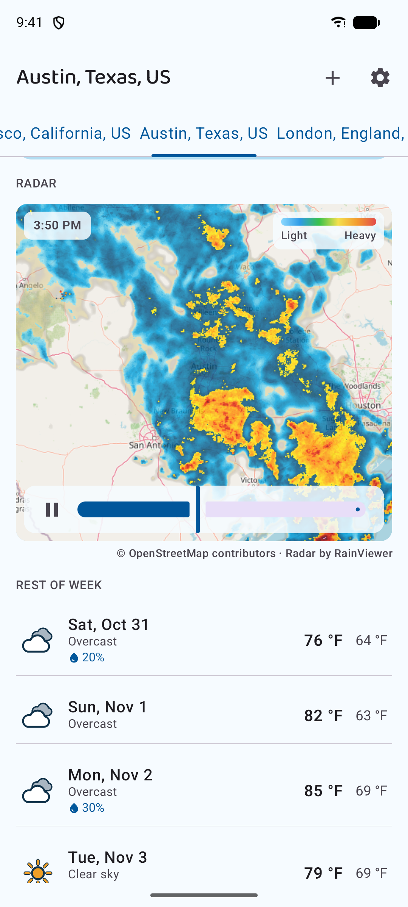
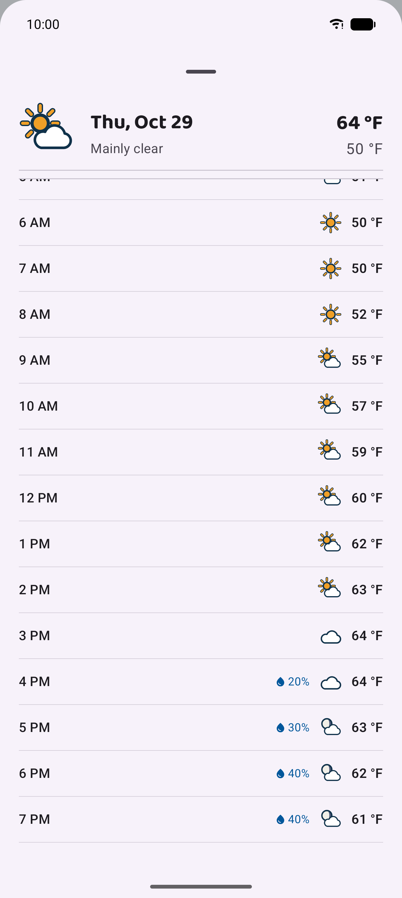
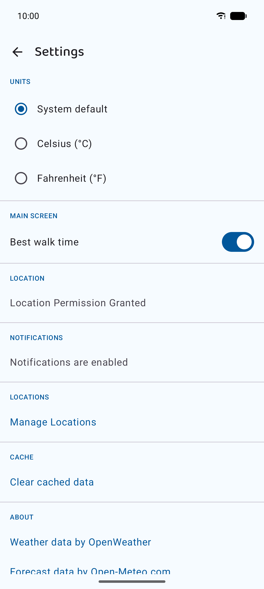
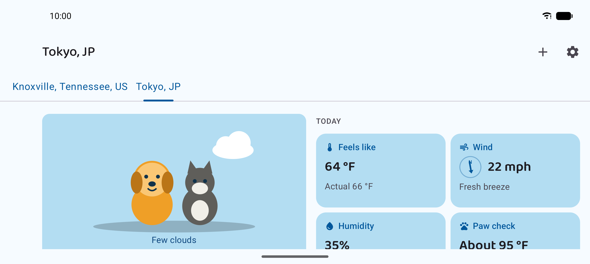
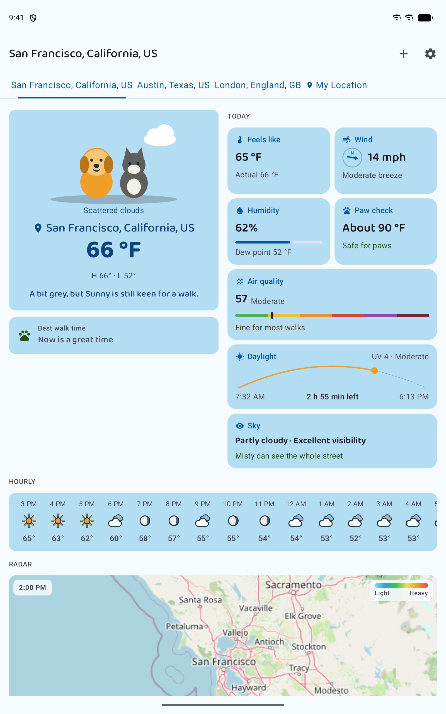

# Sunny & Misty


A clean, modern Android weather app, where Sunny the dog and Misty the cat act out the forecast.
Track current conditions, an hourly and multi-day forecast, and an animated precipitation radar for
any number of saved cities, see when to walk the dog, get a morning briefing, walk-time nudges and rain alerts, and switch
between metric and imperial units. Built with Jetpack Compose and Material 3.

There is also a native iOS version of the same product, built in Swift and SwiftUI:
[tuckercr/weather-iOS](https://github.com/tuckercr/weather-iOS). The two apps share one design,
one Firebase project and the same Remote Config keys, and new features ship on both.

Originally a coding-challenge project, the app has since been extended as a personal showcase of
Android best practices: clean architecture, unidirectional data flow, Hilt DI, background work with
WorkManager, and CI on GitHub Actions.

## Features

- **Current conditions** for any city: temperature, feels-like, daily min/max, humidity, wind
  speed and direction ("0 mph", with no direction, when calm), visibility ("Clear" at
  OpenWeather's 10 km cap), cloud cover, UV index (daytime, from Open-Meteo), and sunrise/sunset.
- **Pets that react to the weather**: Sunny the dog and Misty the cat, drawn in Compose, whose scene
  and caption follow the conditions (sunny, cloudy, rain, storm, snow, hot, cold, night). Captions
  name them ("Sunny wants puddles. Misty wants a towel."), and at night follow the city's time of
  night (evening, late night, before dawn). The night sky shows the moon's real phase, lit from the
  other side in the southern hemisphere.
- **Best walk time** card: "Now is a great time", the next good hour ("Around 8 AM"), or "Not a good
  day for walkies" when nothing in the next 24 hours qualifies. A good hour is under 30% rain
  chance, at a comfortable feels-like temperature, within walking hours and in daylight, and
  below the warm-pavement limit (estimated, with Open-Meteo); when it is raining now, now never counts,
  whatever the hourly forecast says. A suggestion on the city's next calendar day reads "Tomorrow
  around…", judged in the city's own UTC offset. The paw is tinted by the rating, and a caption
  explains hot pavement (naming the pavement only when it's the reason) or freezing weather. Users can turn it off in Settings (*I have a dog*, which hides the Paw check tile too), and
  `walk_card_enabled` hides it remotely.
- **Next rain** line under the top card, only when rain or snow is due in the next 2 hours: "Rain
  starting around 3:15 PM", "Rain stopping around 4:30 PM" or "Rain for the next 2 hours", from
  Open-Meteo's 15-minute forecast (0.1 mm in 15 minutes counts; it stops after 30 dry minutes).
  Rules in `util/NextRain.kt`.
- **Hourly strip** with the next 24 forecast slots (hours from Open-Meteo, 3-hour slots on the
  OpenWeatherMap fallback): time, condition icon, temperature, and rain chance (hidden under 10%,
  otherwise to the nearest 10%, as everywhere in the app). Hours that have
  already passed are dropped at display time (`fromCurrentSlot`), so a cached forecast or an app
  left open never shows or advises on past hours.
- **Weather icons** bundled as vector drawables, drawn in the pets' style with their navy outline so
  they read on light and dark cards. Night icons show the moon's phase for that hour, worked out
  from the date (no API).
- **Multi-day forecast** shown inline, aggregated to the city's local-timezone days with tappable
  day details: each hour's temperature and rain chance.
- **Rain probability** surfaced per hour and per day.
- **Animated radar**: a RainViewer precipitation loop (recent past plus short-range nowcast) over
  an OpenStreetMap base, with a timeline scrubber, colour legend, play/pause, and an
  "© OpenStreetMap contributors · Radar by RainViewer" credit linked under the map. The timeline is
  refetched once it is 10 minutes old (on resume and while the screen stays resumed), and the whole
  section can be switched off remotely with `radar_enabled`.
- **Multiple saved cities** with a scrollable tab row (once two or more are saved) and a Manage
  Locations screen: tap a city to make it active, drag to reorder (TalkBack users get Move up and
  Move down actions), or remove it.
- **Current location** resolved with one tap via fused location services.
- **Local time everywhere**: forecast days, hourly slots, sunrise/sunset, and the radar all render
  in the selected city's timezone.
- **Notifications** for one city, My Location when it's saved and otherwise the first in the list,
  each with its own switch in Settings and its own Android channel:
  - *Morning briefing* at 8:30 AM device time (on): "52° and partly cloudy in Knoxville / High
    70°, low 45°, 60% chance of rain. Sunny's picked 1 PM for a walk." The walk sentence only comes
    with a dog at home; the rain chance from 40%.
  - *Walk time* (only with a dog): the morning run plans a nudge for the day's best walk time, which
    checks again when it's due and only goes if now is still a great time (and there's still a dog).
  - *Rain alerts* (off): the background refresh alerts up to an hour before rain or snow starts,
    from the 15-minute forecast, between 7 AM and 9 PM city time, once per shower.
  `daily_weather_notifications_enabled` switches the briefing off remotely.
- **Unit selection**: System default, Celsius (metric), or Fahrenheit (imperial), chosen in
  Settings. Visibility follows in miles or km (see [Units](#units)).
- **Offline-first**: per-city caching paints instantly, then refreshes silently in the background,
  with cached-data fallback, pull-to-refresh, and inline retry when the network fails. The data
  also refreshes on returning to the foreground (throttled by `foreground_refresh_min_minutes`) and
  every 30 minutes while the screen stays open, and every refresh moves the clock on, so a screen
  left on overnight keeps up.

## Screenshots

| Pets, walk time & hourly | Today tiles & Paw check | Radar & rest of week | Day detail | Settings |
|---|---|---|---|---|
|  |  |  |  |  |

On tablets and in landscape, the pets sit beside today's details and the week splits into two columns:





## Getting started

1. Create a free API key at [openweathermap.org](https://openweathermap.org/api).
2. Add it to `local.properties` (never committed to source control):
   ```
   OWM_API_KEY=your_key_here
   ```
3. Build and run. New keys may take up to 2 hours to activate.

The key is injected at build time into `BuildConfig.OWM_API_KEY`. On GitHub it is stored as an
Actions secret and injected automatically, so no key lives in the repository.

Firebase is optional: without `app/google-services.json` the app builds and runs normally, with
Remote Config falling back to its in-app defaults and analytics and crash reporting doing nothing.
See [Firebase setup](#firebase-setup) to wire it up.

Debug builds install as `com.fangjet.weather.debug` (version name suffixed `-debug`), so they sit
alongside the Play build and report to their own Firebase app.

The app supports Android 10+ (minSdk 29) and targets SDK 37. From the command line:

```bash
./gradlew assembleDebug                   # debug APK
./gradlew test                            # JVM unit tests (:app and :weather-api)
./gradlew :app:connectedDebugAndroidTest  # Compose UI tests on a device or emulator
./gradlew ktlintCheck                     # code style
```

### Release builds

Release builds are minified and resource-shrunk with R8. They are signed when `local.properties`
also provides `KEYSTORE_PATH`, `KEYSTORE_PASSWORD`, `KEY_ALIAS`, and `KEY_PASSWORD`; without those
they build unsigned. CI writes these from the `KEYSTORE_BASE64`, `KEYSTORE_PASSWORD`, `KEY_ALIAS`,
and `KEY_PASSWORD` Actions secrets when they are set, and uploads the debug and release APKs as
build artifacts.

## Architecture & tech stack

| Layer | Choice | Notes |
|---|---|---|
| UI | Jetpack Compose + Material 3 | Single-Activity, screen-level composables, light/dark |
| State | `StateFlow` + `collectAsStateWithLifecycle` | Unidirectional data flow |
| DI | Hilt | Repositories and ViewModels are injected |
| Navigation | Compose Navigation | String route constants in `WeatherDestinations` |
| Background work | WorkManager | Periodic weather refresh (and rain alerts) + the 8:30 AM briefing and walk-time nudge |
| Networking | Retrofit + OkHttp + kotlinx.serialization | Suspend functions, no RxJava |
| Radar | RainViewer + OpenStreetMap tiles | Animated precipitation loop stitched on a Compose `Canvas`; frame speed via Remote Config |
| Images | Coil, vector drawables | Coil loads the radar and base-map tiles; the weather icons are bundled vector drawables |
| Persistence | DataStore Preferences | Onboarding flags, saved cities, active city, unit override, the walk card and *Share usage statistics* settings, per-city cache |
| Analytics | Firebase Analytics, Remote Config, Crashlytics | Optional; no-op without `google-services.json`. No advertising ID; user opt-out and a remote kill switch; Crashlytics in release builds only |
| Modules | `:app`, `:weather-api` | API DTOs, parsing, and the weather, geocoding, and radar repositories split into `:weather-api`, which stays free of Firebase (`ForecastSourcePolicy` carries `open_meteo_enabled` in from the app) |
| Data sources | OpenWeatherMap `/weather` & `/forecast` + Geocoding; Open-Meteo 7-day hourly forecast; RainViewer radar frames; OpenStreetMap tiles | Free tiers; Open-Meteo, RainViewer, and OpenStreetMap need no key |
| CI | GitHub Actions | ktlint, Android Lint, JVM unit tests, debug and release builds, and Compose UI tests (API 34 emulator) on every push to and pull request against `master` |

## App flow

1. **Loading**: reads onboarding state from `DataStore` and routes to the right screen.
2. **Onboarding**: first launch walks through Welcome, notification permission, and location
   permission. Existing installs are migrated so they are never re-prompted.
3. **Current Weather**: shows the active city's conditions, an hourly strip, an animated
   precipitation radar, the pets and best walk time, and the upcoming days inline. Switch between
   saved cities with the tabs, pull to refresh, or add a city by name with autocomplete from the
   [Geocoding API](https://openweathermap.org/api/geocoding-api) (a selected suggestion pins exact
   latitude/longitude so the result is unambiguous).
4. **Forecast**: cities with coordinates use [Open-Meteo](https://open-meteo.com) (true hourly,
   with UV); cities without coordinates, or all cities when the `open_meteo_enabled` Remote Config
   switch is off, use OpenWeatherMap's `data/2.5/forecast` (free tier, 3-hour slots). Each calendar
   day shows the slot closest to local noon, plus the daily high/low and rain chance derived from
   all slots; tapping a day opens its full hourly breakdown.
5. **Radar**: RainViewer radar frames (recent past plus short-range nowcast) are stitched over an
   OpenStreetMap base and animated, with a scrubber, legend, and OpenStreetMap / RainViewer credit
   caption. All frame times display in the selected city's timezone. RainViewer publishes a frame
   every 10 minutes, so a timeline that old is refetched on resume and every 10 minutes while the
   screen is resumed; the current loop stays on screen during the refresh, and a failed refresh
   keeps it.
6. **Settings**, top to bottom:
   - **Units**: System default, Celsius (°C) or Fahrenheit (°F).
   - **My Pets**: *I have a dog* turns on the walk card, the Paw check tile, the briefing's walk
     sentence and the Walk time notification ("Walk times, pavement checks and walk reminders").
     The Walk time notification channel is only created once there's a dog, and never deleted.
   - **Notifications**: a row showing how many are on ("2 on", or "Off"), which opens its own
     screen: a link to the app's system settings while notifications aren't allowed, then a switch
     for each kind (*Morning briefing*, *Walk time*, *Rain alerts*). Walk time only shows with a
     dog, and a kind switched off in Remote Config is hidden. A hidden switch keeps its value.
   - **Location**: permission status, or a link to the app's system settings.
   - **Locations**: *Manage Locations* to add, reorder and delete cities. A bell marks the city
     notifications are for: My Location, otherwise the top city. The city tabs on the main screen
     choose which city it shows.
   - **Cache**: clear cached data.
   - **Privacy**: *Share usage statistics*.
   - **About**: the OpenWeather and Open-Meteo attributions, the
     [privacy policy](https://sunnyandmisty.com/privacy), and the version at the bottom ("Version 1.0",
     with "· Debug build" in debug builds).
7. **Notifications**: WorkManager runs the 8:30 AM briefing (unless `daily_weather_notifications_enabled`
   is off), which also plans the one-off walk-time nudge, and refreshes
   the notification city's cached data (My Location when saved, otherwise the first city) in the background every `weather_refresh_interval_minutes`; the
   schedule survives reboots.
8. **Error handling**: network failures, HTTP errors, empty API keys, and malformed payloads all
   surface as inline error messages with *Retry* where appropriate.

### Trying notifications

Debug builds only (`app/src/debug`), from a computer with the phone on adb, to see each kind without
waiting for 8:30 or the weather. Release builds don't include it, and only the shell can send it
(the receiver needs `android.permission.DUMP`). Notifications must be allowed in the app.

**Samples** post made-up weather for the real notification city (My Location, otherwise the top
city) through the real posting code, so the look, the pet picture, the channel and the tap are all
real. The text follows *I have a dog* the way the real ones do.

```bash
adb shell am broadcast -n com.fangjet.weather.debug/com.fangjet.weather.DebugNotifications --es mode sample --es kind briefing
adb shell am broadcast -n com.fangjet.weather.debug/com.fangjet.weather.DebugNotifications --es mode sample --es kind walk
adb shell am broadcast -n com.fangjet.weather.debug/com.fangjet.weather.DebugNotifications --es mode sample --es kind rain
adb shell am broadcast -n com.fangjet.weather.debug/com.fangjet.weather.DebugNotifications --es mode sample --es kind snow
```

**The real workers** run now, with live weather and the real rules, so they may post nothing: the
walk nudge only when it's a great time for a walk right now (and there's a dog), rain only when the
15-minute forecast has rain within the hour, between 7 AM and 9 PM.

```bash
adb shell am broadcast -n com.fangjet.weather.debug/com.fangjet.weather.DebugNotifications --es mode run --es kind briefing
adb shell am broadcast -n com.fangjet.weather.debug/com.fangjet.weather.DebugNotifications --es mode run --es kind walk
adb shell am broadcast -n com.fangjet.weather.debug/com.fangjet.weather.DebugNotifications --es mode run --es kind rain
```

`run briefing` is the 8:30 run, so it also plans that day's real Walk time nudge. With more than one
device connected, add `-s <serial>` after `adb`. Forcing the scheduled job with
`adb shell cmd jobscheduler run` doesn't work: WorkManager won't run work before its time.

## Analytics & privacy

Sunny & Misty reports a handful of **anonymous app-usage events**: nothing about where you are,
which cities you save, or what the weather is. The whole catalogue is four functions in
[`AnalyticsRepository`](app/src/main/java/com/fangjet/weather/analytics/AnalyticsRepository.kt),
so the privacy policy can be checked against the code line by line.

| Event | Parameters | When |
|---|---|---|
| `onboarding_complete` | None | First-run onboarding finished |
| `city_added` | None | A city was saved (never which one) |
| `settings_opened` | None | Settings opened from the weather screen |
| `weather_error` | `error_key` = `offline` / `rate_limited` / `server_error` / `city_not_found` / `empty_query` / `missing_api_key` / `bad_api_key` / `generic` | A current-weather or forecast load failed (the category only, never coordinates or a city) |

### Gates

An event is sent only if every gate passes:

1. **Remote Config kill switch** `analytics_enabled`: false drops every event, and turns Firebase
   Analytics collection off, on every install without an app update.
2. **The user's own opt-out**: Settings → About → *Share usage statistics* (on by default). It is
   enforced at the SDK level via `setAnalyticsCollectionEnabled`, at app start and whenever it
   changes, so Firebase's automatic events (`first_open`, sessions, screen views) stop too, not
   just ours. Flipping it is deliberately not itself tracked.
3. **Firebase configured**: without `google-services.json` there is no Firebase app and nothing is
   sent.

Debug builds do send, but to their own `com.fangjet.weather.debug` app stream, so development
never pollutes the production numbers. Every analytics call is wrapped so it can never crash the
app; a failure just drops the event.

**No advertising ID.** The app shows no ads, so the manifest strips the `AD_ID` and
`ACCESS_ADSERVICES_*` permissions that `firebase-analytics` merges in, and turns off ad-ID
collection and ad-personalisation signals. Analytics keeps working on its app-instance ID.

Crashlytics is enabled in release builds only (off in debug).

The privacy policy is at [sunnyandmisty.com/privacy](https://sunnyandmisty.com/privacy), linked from
Settings → About → *Privacy Policy*.

## Remote Config

Server-tunable values (17 parameters), so behaviour can change without shipping an update. The
app never blocks on a fetch: it starts from the in-app defaults in
[`remote_config_defaults.xml`](app/src/main/res/xml/remote_config_defaults.xml), reads the last
activated values on cold start, and refreshes in the background at most hourly. Every read is
validated: a missing or bad value falls back to the default rather than crashing.

| Key | Type | Default | What it does |
|---|---|---|---|
| `weather_refresh_interval_minutes` | number | `30` | Background weather refresh interval; values below the WorkManager minimum of 15 are raised to 15 |
| `radar_frame_interval_ms` | number | `850` | Delay between radar animation frames; outside 100–5000 falls back to 850 |
| `radar_enabled` | boolean | `true` | Radar kill switch: false hides the radar section (header and card, phone and tablet layouts) and skips the RainViewer timeline and tile requests, for when RainViewer or the OpenStreetMap tiles become unavailable |
| `walk_card_enabled` | boolean | `true` | Shows the "Best walk time" card; false hides it for everyone (phone and tablet layouts). Users can also turn it off in Settings |
| `open_meteo_enabled` | boolean | `true` | Forecasts for cities with coordinates come from Open-Meteo; false falls back to the OpenWeatherMap 3-hourly forecast by lat/lon (foreground, background refresh, and notifications) |
| `openweather_api_key` | string | `""` | Replacement OpenWeather API key, used from the next app start; empty uses the key built into the app. Lets a leaked key be rotated without an update. Not secret: Remote Config values reach every device |
| `android_min_supported_version` | string | `""` | Below this version (e.g. `1.1`) the app shows only "Time for an update" until it's updated. Empty never asks. iOS has its own key |
| `android_min_recommended_version` | string | `""` | Below this version a banner under the city tabs suggests updating; "Not now" hides it for a week. Empty never asks |
| `daily_weather_notifications_enabled` | boolean | `true` | The 8:30 AM morning briefing; false skips it (the morning run still plans the walk-time nudge) and hides its switch in Settings |
| `walk_time_notifications_enabled` | boolean | `true` | The Walk time nudge; false stops planning and posting it and hides its switch in Settings |
| `rain_notifications_enabled` | boolean | `true` | Rain alerts; false stops them and hides their switch in Settings |
| `foreground_refresh_min_minutes` | number | `0` | Skips the silent refresh on returning to the foreground if that city's weather (or forecast, tracked separately) was fetched within this many minutes in this session; outside 0–1440 falls back to 0, which always refreshes. Pull-to-refresh, retry and switching cities are never throttled |
| `walk_hot_pavement_c` | number | `52` | Pavement °C at or above which the walk rating is *Paws hot* and that hour is not walkable; valid 40–70 |
| `walk_warm_pavement_c` | number | `45` | Pavement °C at or above which the Today Paw check tile says *Getting hot* and that hour is not suggested for a walk (a walk now rates *Okay*); valid 30–65, and below `walk_hot_pavement_c` (otherwise 7 below it) |
| `walk_dangerous_pavement_c` | number | `57.2` | Pavement °C (57.2 is 135 °F) at or above which the Today Paw check tile says *Dangerously hot*; valid 45–80, and above `walk_hot_pavement_c` (otherwise 5 above it) |
| `walk_icy_pavement_c` | number | `0` | Pavement °C below which the Today Paw check tile says *Icy, watch for salt* after rain or snow in the last 12 hours or with snow on the ground, and *Below freezing* otherwise; valid -20–10 |
| `walk_max_rain_chance` | number | `30` | An hour is walkable only below this rain chance (%); whole number, valid 0–100 |
| `walk_comfort_min_c` | number | `3` | Coldest comfortable walking temperature (°C, feels-like); valid -20–20, and below `walk_comfort_max_c` |
| `walk_comfort_max_c` | number | `27` | Warmest comfortable walking temperature (°C, feels-like); valid 15–40, and above `walk_comfort_min_c` |
| `walk_hours_start` | number | `7` | First local hour a walk may be suggested (inclusive); whole number, valid 0–23, and before `walk_hours_end` |
| `walk_hours_end` | number | `20` | Last local hour a walk may be suggested (inclusive); whole number, valid 0–23, and after `walk_hours_start` |
| `pet_hot_threshold_c` | number | `30` | At or above this °C (feels-like) the pets look hot and the walk rating is *Paws hot*; valid 20–45, and above `pet_cold_threshold_c` |
| `pet_cold_threshold_c` | number | `0` | At or below this °C (feels-like) the pets look cold and the walk rating is *Too cold*; valid -20–10, and below `pet_hot_threshold_c` |
| `analytics_enabled` | boolean | `true` | Analytics kill switch; see [Gates](#gates) |

The walk and pet-mood thresholds are always Celsius, whatever units the user picks. A value outside
its valid range (or a fractional value for a whole-number key) falls back to its default, and so
does any pair that isn't strictly ordered (comfort min/max, walk hours start/end, pet cold/hot):
both values of the pair revert together. Validation lives in
[`PetWeatherThresholds`](app/src/main/java/com/fangjet/weather/domain/PetWeatherThresholds.kt).

[`firebase/remoteconfig.template.json`](firebase/remoteconfig.template.json) is the source of truth
for the console parameters; keep it, `remote_config_defaults.xml`, and
[`RemoteConfigRepository`](app/src/main/java/com/fangjet/weather/data/RemoteConfigRepository.kt)
in step.

## Firebase setup

The app is wired to the Firebase project **`cats-dogs-weather`** (Analytics, Remote Config,
Crashlytics). To build against it, or your own:

1. Create a project at [console.firebase.google.com](https://console.firebase.google.com) **with
   Google Analytics enabled**, as events silently no-op if the project has no linked Analytics
   property.
2. Register **two** Android apps under it: `com.fangjet.weather` and `com.fangjet.weather.debug`.
   Debug builds use an `applicationIdSuffix`, and the `google-services` plugin matches package
   names exactly.
3. Download the merged `google-services.json` to `app/`. It is git-ignored; each developer
   supplies their own. CI restores it from the base64-encoded `GOOGLE_SERVICES_JSON` Actions secret
   when that is set, and builds without Firebase when it isn't.
4. Deploy the Remote Config parameters from this repo (the default project is set in
   [`.firebaserc`](.firebaserc)):
   ```bash
   firebase deploy --only remoteconfig
   ```
   `firebase remoteconfig:get` shows what is live. See [`firebase/README.md`](firebase/README.md).
5. In Analytics settings, set data retention to **14 months**.

## Unit tests

JVM unit tests (JUnit 4, MockK, and `kotlinx-coroutines-test`) live in `weather-api/src/test` and
`app/src/test`; `./gradlew test` runs both.

| Module | Test class | What it covers |
|---|---|---|
| `:weather-api` | `ForecastAggregatorTest` | Noon-slot selection, grouping by the city's local days (not UTC), daily min/max and rain chance, chronological hourly slots |
| `:weather-api` | `OpenMeteoForecastSourceTest` | Open-Meteo mapping: drops past hours, city-timezone grouping and labels (half-hour offsets, DST), weather codes, UV, pavement heat |
| `:weather-api` | `WeatherHelpersTest` | WMO weather-code mapping to conditions and day/night icons; pavement-heat estimate |
| `:weather-api` | `OpenWeatherParsingTest` | Kotlinx Serialization parsing of OpenWeatherMap current-weather and forecast payloads, including the UTC offset |
| `:weather-api` | `GeocodingDirectParsingTest` | Geocoding payload parsing when `state` is omitted |
| `:weather-api` | `GeocodingRepositoryTest` | City search: input trimming, label formatting, short-query and missing-key short-circuits, failure wrapping |
| `:weather-api` | `WeatherRepositoryTest` | Repository contract: coordinate routing (incl. `open_meteo_enabled` on/off and a failing `ForecastSourcePolicy`), city-query trimming, error mapping |
| `:weather-api` | `RadarRepositoryTest` | RainViewer timeline parsing, past/nowcast frame ordering, and tile URLs |
| `:weather-api` | `CurrentWeatherTest` | UTC-offset handling, including caches written before the offset existed |
| `:weather-api` | `WeatherUnitsTest` | Celsius conversion and locale-to-unit mapping (US and territories imperial, others metric) |
| `:app` | `WeatherForecastViewModelTest` | Cache-first loading, refresh races, background-refresh staleness guards, the `foreground_refresh_min_minutes` throttle, `walk_card_enabled`, and Remote Config pet thresholds |
| `:app` | `RadarViewModelTest` | Stale-timeline refresh (10 minutes, measured from the request), keeping the old timeline on a failed refresh, and `radar_enabled` gating |
| `:app` | `SettingsViewModelTest` | Unit-override selection, *Share usage statistics*, the walk card setting, and cache clearing |
| `:app` | `AnalyticsRepositoryTest` | Analytics gates: kill switch, user opt-out, both on, and never crashing |
| `:app` | `AnalyticsCollectionControllerTest` | SDK collection flag follows the opt-out and kill switch, at start and on change |
| `:app` | `PetWeatherThresholdsTest` | Remote Config threshold validation: ranges, non-finite values, and pair ordering fallbacks |
| `:app` | `PetMoodTest` | Pet mood selection by conditions, temperature, and night, with configurable hot/cold cut-offs; night captions by the city's local hour |
| `:app` | `WalkAdvisorTest` | Walk rating and best time: rain, comfort range, walking hours, daylight, raining now, pavement heat, imperial input, "tomorrow" in the city's calendar, 24-hour cap |
| `:app` | `MoonPhaseTest` | The moon's phase from the date, checked against published phases |
| `:app` | `WeatherIconTest` | Icon for each condition by day and night, moon phases, and southern-hemisphere mirroring |
| `:app` | `CalmWindTest` | Calm wind reads as 0, and visibility at the 10 km cap reads as clear |
| `:app` | `DistanceUnitsTest` | Visibility in miles or km: the unit choice, or the measurement system for "System default" |
| `:app` | `AppConfigModuleTest` | The OpenWeather key: a Remote Config replacement wins over the built-in key |
| `:app` | `CurrentSlotsTest` | `fromCurrentSlot`: drops past hourly and 3-hourly slots, keeps the one in progress |
| `:app` | `LocaleWeatherUnitsTest` | An explicit Celsius/Fahrenheit system preference beats the locale; unknown falls back to it |
| `:app` | `WelcomeViewModelTest` | Onboarding state and persistence |
| `:app` | `CityListViewModelTest` | Add, remove, reorder, active-city tracking, legacy single-city migration, and `city_added` firing |
| `:app` | `GeoLocationViewModelTest` | City autocomplete: short input, latest search wins, pinned coordinates from a suggestion |
| `:app` | `LocationPermissionViewModelTest` | Current-location lookup: permission denial, cached vs current location, failure |
| `:app` | `NotificationWorkerLogicTest` | Briefing text, walk-time planning and nudge, rain alerts (lead, quiet hours, once per shower), city-timezone "today" matching, and the switches |
| `:app` | `UpdateWorkerLogicTest` | Background refresh result routing, caching, and resolved units |

Compose UI tests live in `app/src/androidTest` and run on an emulator in CI via a separate
`instrumented-tests` job:

| Test class | What it covers |
|---|---|
| `WelcomeScreenTest` | Welcome copy and the *Get started* callback |
| `OnboardingNotificationScreenTest` | Notification onboarding copy, both buttons, and *Not now* |
| `CurrentWeatherScreenTest` | Current-weather screen states: empty, error with retry, forecast error, upcoming day, hourly strip and rain chance, radar shown by default and hidden when `radar_enabled` is off |
| `LocationsScreenTest` | Manage Locations: tapping a row makes it active, Move up / Move down accessibility actions, delete buttons name their city |

## Units

Users choose their preferred units in Settings: **System default**, **Celsius (°C)** (metric), or
**Fahrenheit (°F)** (imperial). When set to System default, the app reads the Android 14+ temperature
preference where available, and otherwise falls back to a locale-based heuristic (the US and its
territories to Fahrenheit, otherwise Metric).

Visibility follows the same choice: km for Celsius, miles for Fahrenheit. For System default it
follows the system's measurement system, where the US and UK use miles (Android 9+; earlier
versions use the same locale heuristic).

## Accessibility

- TalkBack labels on every control. Settings' unit choices are single radio items, the radar slider
  reads as the frame's time, and Manage Locations rows offer Move up and Move down actions in place
  of dragging.
- Touch targets of at least 48 dp.
- Text meets WCAG AA contrast: the light theme's primary is `#01579B`, and in dark mode the paw and
  icons keep their contrast against the cards.
- Layouts reflow at the largest font sizes.
